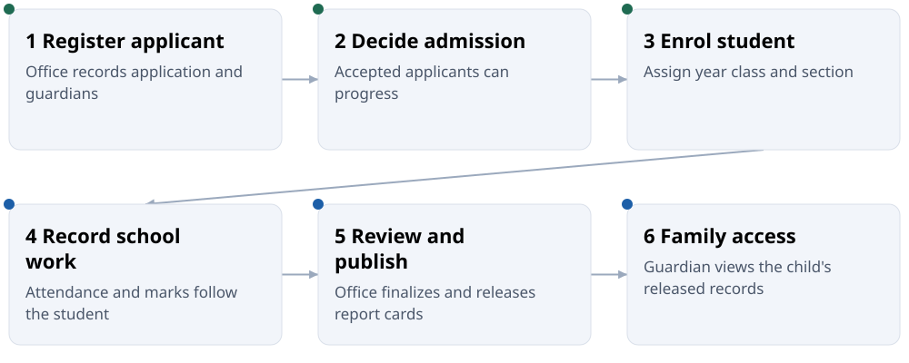
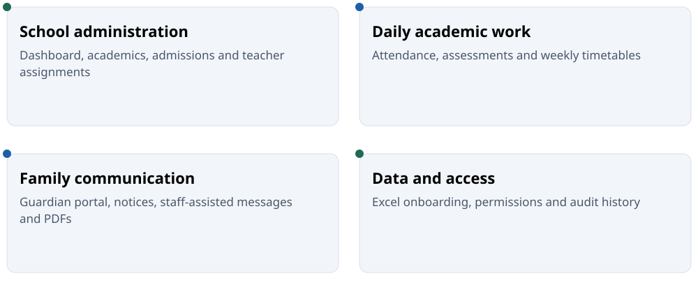
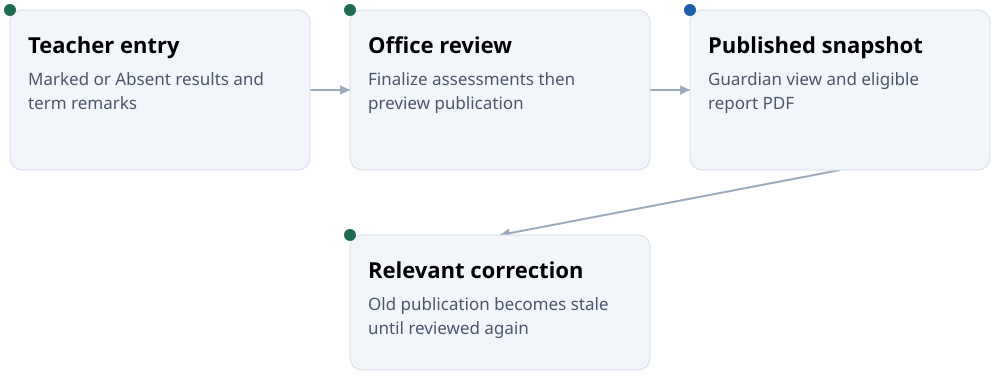

<!-- _class: lead -->
# School ERP

## One connected record for everyday school work

Admissions · Attendance · Assessments · Report cards

**A discussion draft for private-school management**

---

# When school work is fragmented

- Admissions records, registers, marks and reports may sit in different places.
- Teachers need a clear view of the classes and work assigned to them.
- School management needs to review progress before results reach families.
- Guardians need secure access to information about their own children.

**Our focus:** help the school keep these connected workflows organized.

---

<!-- _class: diagram -->
# Follow a student from admission to results

*The office decides admissions. Guardians see records only after the school grants access or publishes results.*

---

<!-- _class: diagram -->
# Twelve product areas, one connected system

*The feature catalogue documents these workflows as areas M01–M12. School-specific needs are assessed separately.*

---

# Administrator: coordinate school work

- Set up academic years, terms, classes, sections, subjects and calendars.
- Review applications, admit students and maintain their placement history.
- Manage teaching assignments and review attendance or assessment progress.
- Control report-card publication, notices, documents and permitted corrections.

**The school office decides what is finalized and released.**

---

# Teacher: focus on assigned classes

- **My day** shows relevant work and configured timetable periods.
- **My Students** follows the teacher's authorized classes and school year.
- Take attendance and submit a complete class register.
- Enter marks for assigned subjects; add class-teacher remarks where permitted.

**Teachers do not need full administrator access to complete their work.**

---

# Guardian: access the right information

- Sign in to view children for whom portal access has been approved.
- Read submitted attendance and the child's school information.
- Open published term report cards and eligible PDF downloads.
- See notices meant for that child's school, class or section.

**Unpublished marks are not shown to guardians.**

---

<!-- _class: diagram -->
# Marks stay private until the school publishes

*The office checks and explicitly publishes a report card before it appears in the Guardian Portal.*

---

# Daily operations, made easier to review

- **Timetable:** view weekly periods and identify known teacher clashes.
- **Attendance:** distinguish submitted registers from missing entries.
- **Notices:** post to the whole school, one class or one section.
- **Documents:** bonafide, attendance summary and eligible report-card PDFs.
- **Excel import:** preview and correct spreadsheet problems before confirming.

---

<!-- _class: compact -->
# What is included — and what needs discussion

| Current demonstration scope | Separately assessed requests |
|---|---|
| Admissions, enrollment and academic setup | Fees and online payment collection |
| Class attendance and assessment workflows | Bulk academic-year rollover |
| Guardian portal and published report cards | Transfer certificates and board-specific calculations |
| Timetable, notices and supported PDFs | Automated WhatsApp API, SMS or email delivery |
| Installable **online-only** PWA | Native apps, offline workflows and multi-school SaaS |

**WhatsApp Assist prepares messages; staff complete any send in WhatsApp.**

---

# Implementation starts with your school

1. **Understand needs** — priorities, policies, forms and approval roles.
2. **Agree the scope** — existing features versus custom development.
3. **Prepare the setup** — school structure, accounts and validated data.
4. **Review together** — training, permissions and acceptance checks.
5. **Support operation** — responsibilities and ongoing service agreed in writing.

**Commercial approach:** customized installation, setup fee and annual support. Pricing and dates require a school-specific proposal.

---

<!-- _class: lead -->
# What matters most to your school?

### Which two or three workflows would you improve first?

What formats and policies must the system follow?

Who will coordinate requirements and approve the scope?

**Next:** requirements review → written scope → quotation and implementation proposal

