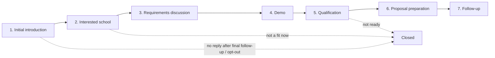

# Proposed sales process

> **Draft — Internal review only.** GTM-OUTREACH-01. A proposed workflow for owner review. It approves no prices, hosting arrangements, delivery dates, service levels or custom development. Roles are named by function. The owner assigns real people outside Git.

## Stages

Stages 3 and 4 can swap: some schools want to see the product before discussing requirements in detail. Record whichever comes first.

## Internal roles (to be assigned by the owner)

| Role | Responsibility |
|---|---|
| **Outreach lead** | First contact, follow-ups, lead tracker upkeep, opt-out handling |
| **Demo presenter** | Demo preparation against the [pre-demo checklist](../../demo/demo-checklists/pre-demo-readiness.md) and delivery |
| **Solution lead** | Requirements discussion, fit against the [feature catalogue](../../docs/product/feature-catalogue.md), classification of new requests |
| **Commercial approver (owner)** | Approves every proposal, quotation, price, term and commitment before it reaches a school |

One person may hold more than one role. The owner remains the only person who can approve commercial terms.

## Stage details

| # | Stage | Enters when | Next action | Internal owner | Exit / output |
|---|---|---|---|---|---|
| 1 | **Initial introduction** | There is a reasonable basis to contact the school ([controls](privacy-and-outreach-controls.md)) | Send one introduction (templates [1](outreach-templates.md#1-initial-whatsapp-introduction)–[4](outreach-templates.md#4-in-person-school-visit)) and record it in the private tracker | Outreach lead | Reply received → 2. No reply after one follow-up and the [final follow-up](outreach-templates.md#8-polite-final-follow-up-no-response) → Closed |
| 2 | **Interested school** | The school replies positively or enquires | Reply within two working days ([template 6](outreach-templates.md#6-follow-up-after-an-enquiry)); ask the first qualification questions; offer a demo or requirements call | Outreach lead | A meeting is agreed → 3 or 4 |
| 3 | **Requirements discussion** | The school agrees to discuss needs | Use the [requirements capture sheet](../proposals/school-requirements-capture.md); classify each request; request fictional or redacted format samples if needed | Solution lead | Priorities and must-have areas recorded privately |
| 4 | **Demo** | A demo date is agreed ([template 5](outreach-templates.md#5-demo-invitation)) | Complete the pre-demo checklist; run the [8-minute](../../demo/presenter-scripts/executive-demo-8-minute.md) or 30-minute script focused on the school's priorities; send [template 7](outreach-templates.md#7-follow-up-after-a-demonstration) within two working days | Demo presenter | Demo held; questions and requests recorded |
| 5 | **Qualification** | Requirements and demo are done | Rate the lead with the [qualification guide](lead-qualification.md); confirm the decision-maker, data migration needs and separate-assessment items | Solution lead | Ready → 6. Developing → back to 3 or 4. Early → one agreed follow-up or Closed |
| 6 | **Proposal preparation** | The lead is rated Ready and the school asks for a proposal | Draft from the [proposal](../proposals/school-proposal-template.md), [quotation](../proposals/quotation-template.md), [scope](../proposals/implementation-scope-template.md) and [support](../proposals/annual-support-template.md) templates; owner review and approval **before** anything is sent | Solution lead drafts; commercial approver approves | Approved proposal sent by hand, or proposal paused pending owner decisions |
| 7 | **Follow-up** | A proposal has been sent | Agree a follow-up date with the school; answer questions from the [sales FAQ](../faq/sales-faq.md) and [objections](../objection-handling/common-objections.md); route any change in scope or terms back to the owner | Outreach lead, with the commercial approver for any term change | School decides; or no reply after final follow-up → Closed |

## Rules that apply at every stage

- Nothing goes to a school without a person reviewing it. Commercial documents also need the owner's approval.
- No price, discount, hosting arrangement, delivery date, support hours, service level or custom-development promise before the owner approves it in a written proposal. The open decisions are listed in the [pricing framework](../pricing/pricing-framework.md).
- Requests outside the current product are recorded as **separate assessment** and never described as available.
- Never share demo credentials or private staging URLs.
- Prospect details and notes stay outside Git.
- An opt-out at any stage closes the lead immediately.

## Open decisions for the owner

1. Who holds each internal role
2. Where the private lead tracker is stored and who can access it
3. Whether the follow-up limits and response times in this kit are acceptable
4. When outreach may begin (see the owner checklist in the [controls](privacy-and-outreach-controls.md#before-outreach-begins-owner-checklist))
